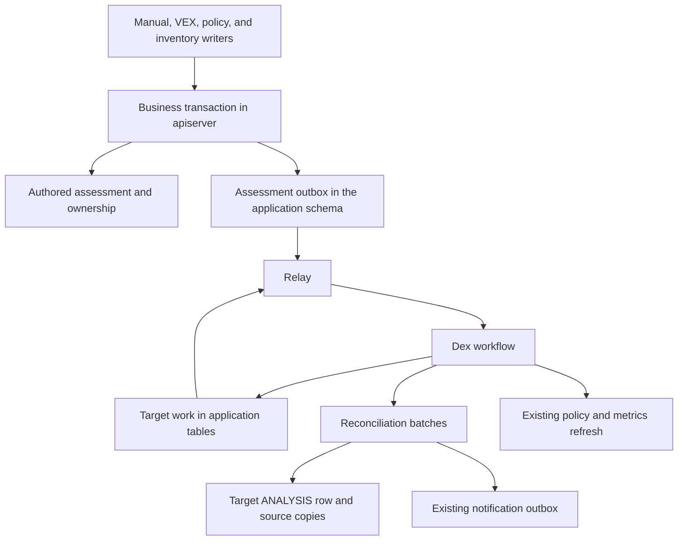
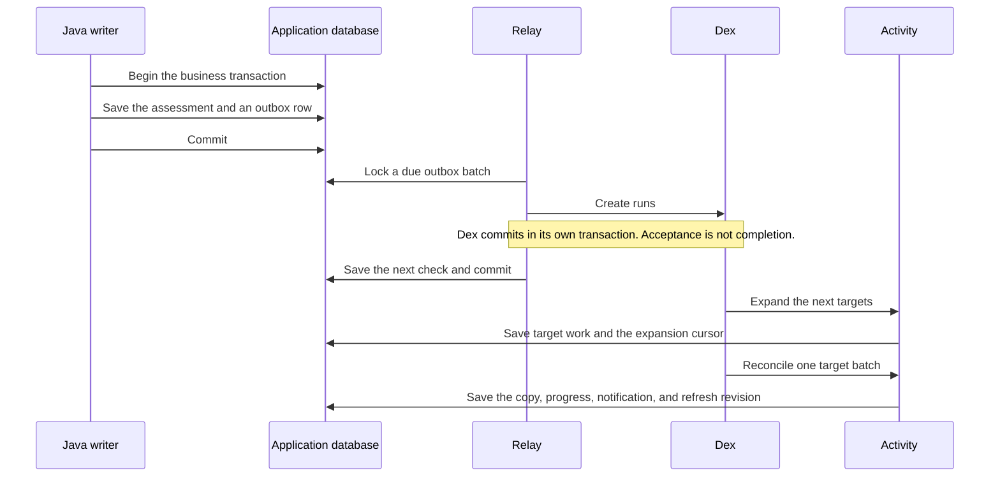
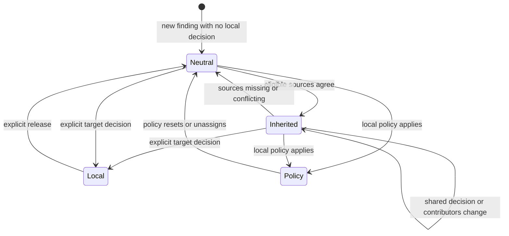

| Status   | Date       | Author(s)                              |
|:---------|:-----------|:---------------------------------------|
| Proposed | 2026-10-22 | [@Nihad74](https://github.com/Nihad74) |

## Context

A project can include another project in its bill of materials. That other project may already have vulnerability assessments for components that also exist in the first project. Those assessments stay on the source. The project that includes it does not pick them up. A later change on the source is easy to miss when someone copies the assessment by hand, with a script, or in a separate VEX file.

A parent in the portfolio is a different relationship. It does not say which included project the assessments come from.

Several pressures pull in different directions.

The project default is strong consistency. A source edit and every copy cannot share one database transaction. The source request would then wait for every target, lock more rows, and fail when any target fails. [Strong consistency](../../DEVELOPING.md#strong-consistency-by-default) allows a weaker guarantee only when the use case needs it and the trade-off is written down. This record is that write-down.

New persistence code uses JDBI and raw SQL. [JDBI persistence](../../DEVELOPING.md#persistence-prefer-jdbi-and-raw-sql) says not to build new features on JDO entities.

The design should stay small. A generic event bus, a new broker, or a second workflow runner would exist for a later use case that we do not have. [Simple and pragmatic](../../DEVELOPING.md#simple-and-pragmatic-over-speculative-future-proofing) says to solve the problem in front of us.

Work that continues after the source request must survive a crash. [ADR 002](./002-workflow-orchestration.md) already runs long-lived work on the Dex workflow engine. [ADR 011](./011-notification-outbox.md) already records notifications in a transactional outbox and relays them to Dex. Dex accepting a run is not the same as finishing the business work. The notification relay deletes its outbox row after Dex accepts the run. Assessment copies, reconciliation, and refresh can still be unfinished at that moment. This feature cannot use that same point as "done."

This record stays Proposed. It does not claim maintainer acceptance. It does not claim a measured portfolio size, a latency budget, or a service level.

### Possible Solutions

#### A: Update the source and every target in one transaction

*Pro*:

* Every target would see the new decision when the source transaction commits.

*Con*:

* The source request would lock and wait for every target. One target failure would roll back the source change. The only step that stays inside the target's own analysis transaction is the existing setup of a new finding.

#### B: Publish an in-memory event after commit

*Pro*:

* The application change is small.

*Con*:

* A crash after commit drops the signal. Targets can miss the change for good. A durable copy needs a record that commits with the source change.

#### C: Capture changes with database triggers or change data capture

*Pro*:

* Triggers and change data capture see a write even when one application path forgets to record it.

*Con*:

* Capture is an explicit Java hook inside the business transaction. Triggers and change data capture are not used. Missed hooks are covered by a writer inventory, producer tests, and a later check that can repair drift.

#### D: Add a generic transactional event framework

*Pro*:

* Later features could share one outbox.

*Con*:

* There is no second concrete use case. A shared framework would be a broad refactor. The notification outbox in [ADR 011](./011-notification-outbox.md) already has a different lifecycle. This feature keeps its own recorder and relay in `apiserver`.

#### E: Run synchronization in a standalone executor

*Pro*:

* The executor could read and write the database without a workflow layer.

*Con*:

* [ADR 002](./002-workflow-orchestration.md) already runs durable work on Dex. A second executor would do that job again. Dex activities perform the work. Progress stays in application tables.

#### F: Use a message broker or event sourcing

*Pro*:

* A broker can move work between services. Event sourcing can keep a full history of every change.

*Con*:

* [ADR 001](./001-drop-kafka-dependency.md) removed the Kafka dependency. There is no current need for another broker or for a full event history. Synchronization compares the current state. A log of invalidations cannot rebuild source rows that are already gone.

#### G: Rebuild every affected assessment on every change

*Pro*:

* The rule is easy to explain.

*Con*:

* Unrelated findings would be processed again. A change to one finding updates that finding. A change to the project, and a repair, reconcile the affected target.

#### H: Resolve the source decision when the target is read

*Pro*:

* Readers would see the latest source decision. The target would not store a copy.

*Con*:

* Ordinary readers of machine fields keep using the stored target `ANALYSIS` row. They do not look up the source decision at read time.

#### I: Pick one winning source when several sources exist

*Pro*:

* The target would store fewer provenance rows.

*Con*:

* One winner would hide a later disagreement and would drop the other authors. Version one stores every current contributor.

## Decision

We will keep copying authored vulnerability assessments from an included source project onto matching findings that the target project already owns.

Capture is a Java hook inside the business transaction. The hook writes the domain change and an outbox row together. Database triggers are not used. Change data capture is not used.

The outbox lives in the application schema. A small relay in `apiserver` then hands due work to the existing Dex engine from [ADR 002](./002-workflow-orchestration.md). Dex accepting a run is not completion. The outbox row stays until the affected targets have been listed. Target work stays in application tables until reconciliation and the required refresh have finished. A failed Dex run does not throw that work away. This differs on purpose from the notification outbox in [ADR 011](./011-notification-outbox.md), which deletes a row after the relay has handed it to Dex.

The source transaction does not call Dex. It does not walk the portfolio. It does not wait for target projects. One reconciliation transaction does not cover every target.

Weaker consistency is an explicit exception to [strong consistency](../../DEVELOPING.md#strong-consistency-by-default). Ordinary readers use the stored target `ANALYSIS` row. They do not resolve the source decision at read time.

In version one, the authors that can be copied are a manual decision, a VEX import, and a vulnerability policy. An inherited row is not an author. It does not feed another project.

When more than one eligible source matches, the target inherits only when the whole structured decision agrees. That decision is the state, justification, response, suppression, severity, and any CVSS or OWASP override. The written explanations may differ. Each explanation stays with its source. When the structured decisions disagree, inherited machine values are withdrawn. No source is chosen as the winner.

An explicit local decision on the target protects the whole assessment. Existing target analyses are protected, including a row whose state is `NOT_SET`. A comment that does not change the decision keeps the current owner. In the diagram below, neutral means the target has no local decision. A stored `NOT_SET` row is still local.

Source explanations, comments, authors, and identifying provenance require current access to the source and current access to the target.

Synchronization does not create findings. It does not add an external broker, a generic event bus, new JDO entities, or changes to the Dex engine. New tables use raw SQL and JDBI, as [JDBI persistence](../../DEVELOPING.md#persistence-prefer-jdbi-and-raw-sql) requires. The feature stays inside `apiserver`. It does not add a generic messaging module, which [simple and pragmatic](../../DEVELOPING.md#simple-and-pragmatic-over-speculative-future-proofing) rules out until a second concrete use case exists.

The feature ships disabled. Its mode is off until an operator turns it on.

In scope: a continuous copy of authored assessments onto findings the target already has, a durable outbox and target work in the application schema, Dex execution with progress stored until refresh finishes, agreement across sources, and protected local rows.

Out of scope: new findings, database triggers, change data capture, an external broker, a generic event bus, new JDO entities, Dex engine changes, a project-mapping screen, and a new vulnerability scanner. Version one does not let an inherited row feed another project. It does not pick a winning source. It does not resolve the source decision at read time.

## Consequences

Many existing writers need a hook inside their own transaction. Examples are a manual assessment, a VEX import, a vulnerability policy, a bill of materials or component change, and project deletion. A missed hook stays silent until verification runs.

Verification and repair are required. The same reconciliation used for a normal update must be able to compare the current source and target and repair drift.

An inherited copy can lag behind the source. A reader of the target sees the last reconciled `ANALYSIS` row.

Local ownership and source confidentiality add work on the read path. The API must hide source text and provenance when the caller cannot access the source. It must leave a protected local row unchanged.

Rollback removes copies owned by the synchronization worker. The new tables stay while those copies exist. Dropping the tables is not the rollback in that situation.

Operators start with the feature off. Turning it on is a separate operational choice.
