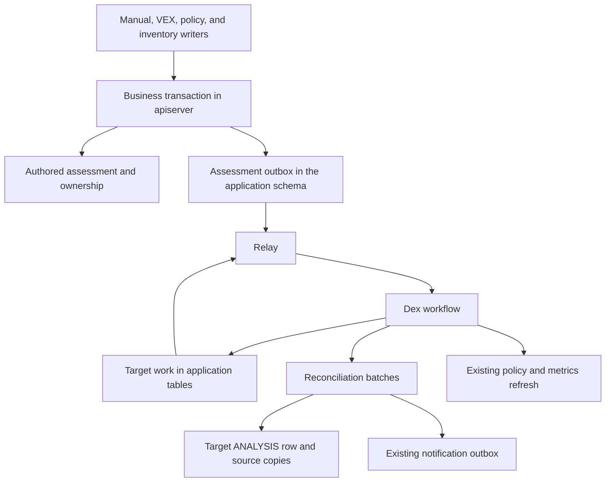
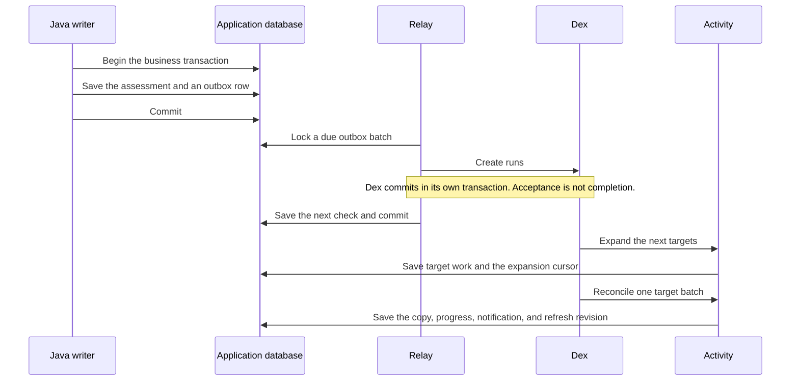
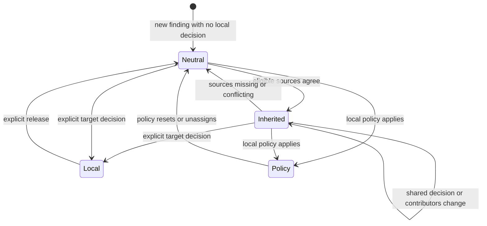

| Status   | Date       | Author(s)                              |
|:---------|:-----------|:---------------------------------------|
| Proposed | 2026-10-22 | [@Nihad74](https://github.com/Nihad74) |

## Context

A project can include another project in its bill of materials. That other project may already have vulnerability assessments for components that also exist in the first project. Those assessments stay on the source. The project that includes it does not pick them up. A later change on the source is easy to miss when someone copies the assessment by hand, with a script, or in a separate VEX file.

A parent in the portfolio is a different relationship. It does not say which included project the assessments come from.

Several pressures pull in different directions.

The project default is strong consistency. A source edit and every copy cannot share one database transaction. The source request would then wait for every target, lock more rows, and fail when any target fails. [Strong consistency](../../DEVELOPING.md#strong-consistency-by-default) allows a weaker guarantee only when the use case needs it and the trade-off is written down. This record is that write-down.

[ADR 037](./037-portfolio-finding-lists-live-not-materialized.md) adds that the database is a security record. Suppression and analysis state must be current. A design that accepts staleness has to justify it.

New persistence code uses JDBI and raw SQL. [JDBI persistence](../../DEVELOPING.md#persistence-prefer-jdbi-and-raw-sql) says not to build new features on JDO entities.

The design should stay small. A generic event bus, a new broker, or a second workflow runner would exist for a later use case that we do not have. [Simple and pragmatic](../../DEVELOPING.md#simple-and-pragmatic-over-speculative-future-proofing) says to solve the problem in front of us.

Work that continues after the source request must survive a crash. [ADR 002](./002-workflow-orchestration.md) already runs long-lived work on the Dex workflow engine. [ADR 011](./011-notification-outbox.md) already records notifications in a transactional outbox and relays them to Dex. Dex accepting a run is not the same as finishing the business work. The notification relay deletes its outbox row after Dex accepts the run. Assessment copies, reconciliation, and refresh can still be unfinished at that moment. This feature cannot use that same point as "done."

This record stays Proposed. It does not claim maintainer acceptance. It does not claim a measured portfolio size, a latency budget, or a service level.

### Possible Solutions

#### A: Update the source and every target in one transaction

*Pro*:

* Every target would see the new decision when the source transaction commits.

*Con*:

* The source request would lock and wait for every target. One target failure would roll back the source change.

#### B: Publish an in-memory event after commit

*Pro*:

* The application change is small.

*Con*:

* A crash after commit drops the signal. Targets can miss the change for good. A durable copy needs a record that commits with the source change.

#### C: Capture changes with database triggers or change data capture

*Pro*:

* Triggers and change data capture see a write even when one application path forgets to record it.

*Con*:

* A trigger sees a row change, not the intent of the writer. It cannot tell an explicit local decision from a comment, or an authored write from a write by the synchronization worker. Ownership depends on exactly that difference.
* Change data capture needs the `REPLICATION` attribute and replication slot monitoring. [ADR 011](./011-notification-outbox.md) rejected it for these reasons.

#### D: Add a generic transactional event framework

*Pro*:

* Later features could share one outbox.

*Con*:

* There is no second concrete use case. A shared framework would be a broad refactor. The notification outbox in [ADR 011](./011-notification-outbox.md) already has a different lifecycle. This feature keeps its own recorder and relay in `apiserver`.

#### E: Run synchronization in a standalone executor

*Pro*:

* The executor could read and write the database without a workflow layer.

*Con*:

* [ADR 002](./002-workflow-orchestration.md) already runs durable work on Dex. A second executor would do that job again. Dex activities perform the work. Progress stays in application tables.

#### F: Use a message broker or event sourcing

*Pro*:

* A broker can move work between services. Event sourcing can keep a full history of every change.

*Con*:

* [ADR 001](./001-drop-kafka-dependency.md) removed the Kafka dependency. There is no current need for another broker or for a full event history. Synchronization compares the current state. A log of invalidations cannot rebuild source rows that are already gone.

#### G: Rebuild every affected assessment on every change

*Pro*:

* The rule is easy to explain.

*Con*:

* Unrelated findings would be processed again. One source project can be included in many products. One comment on one source finding would then start a full pass over every finding of every product that includes the source. Merging pending work softens a burst of edits, but a single edit still pays the full price.

#### H: Resolve the source decision when the target is read

*Pro*:

* Readers would see the latest source decision. The target would not store a copy.

*Con*:

* Dozens of existing queries read the target `ANALYSIS` row directly. They serve findings, notifications, vulnerability and component policies, metrics, and VEX and VDR exports. Each of them would need source matching, agreement, ownership, and access checks.
* [ADR 037](./037-portfolio-finding-lists-live-not-materialized.md) shows that a severity computed at read time already prevents index-backed sorting. A severity that is also resolved across projects makes this worse.

#### I: Pick one winning source when several sources exist

*Pro*:

* The target would store fewer provenance rows.

*Con*:

* One winner would hide a later disagreement and would drop the other authors. Version one stores every current contributor.

## Decision

We will copy authored vulnerability assessments from an included source project onto matching findings that the target project already owns.

Capture is a Java hook inside the business transaction. The hook writes the domain change and an outbox row together. Database triggers are not used. Change data capture is not used.

The outbox lives in the application schema. A small relay in `apiserver` then hands due work to the existing Dex engine from [ADR 002](./002-workflow-orchestration.md). Dex accepting a run is not completion. The outbox row stays until the affected targets have been listed. Target work stays in application tables until reconciliation and the required refresh have finished. A failed Dex run does not throw that work away. This differs on purpose from the notification outbox in [ADR 011](./011-notification-outbox.md), which deletes a row after the relay has handed it to Dex.

The business transaction cannot create a Dex run itself. The Dex engine can run on its own data source, so one transaction cannot cover both. The outbox closes that gap.

The source transaction does not call Dex. It does not walk the portfolio. It does not wait for target projects. One reconciliation transaction does not cover every target.

Weaker consistency is an explicit exception to [strong consistency](../../DEVELOPING.md#strong-consistency-by-default). Ordinary readers use the stored target `ANALYSIS` row. They do not resolve the source decision at read time.

Un-suppression is the direction that matters for safety. When a source changes from not affected to exploitable, the target stays suppressed until reconciliation runs. The normal delay is the time needed to drain the backlog. Operators can see the age of the oldest outbox row and the age of the oldest unfinished target work. A writer that misses its hook leaves the target stale until the next verification run, which is daily by default. This record does not promise a numeric delay.

### Which project is a source

A target component marks an included source when all of these are true:

* It can be reached from the target project through the stored dependency graph.
* Its classifier is one of application, container, operating system, firmware, device, or platform. Libraries, frameworks, files, data, device drivers, machine learning models, and cryptographic assets never mark a source. A new classifier is not a marker until a later change adds it.
* Its name and version are equal, case-sensitive, to exactly one other project that is active and is not a collection project. An ambiguous match gives no source.

The portfolio parent is not consulted. The components inside the scope are the components strictly below the marker in the dependency graph. A component that is also reached from outside that subtree is still in scope. This is a chosen reuse policy. Package identity alone does not prove that a decision applies in every product context.

Creating, renaming, cloning, or deleting a project changes which markers resolve. These writers record a change, and the affected targets are indexed again. A new version of the source is a different project. When a product moves to that version, the inherited values from the old version are withdrawn.

When portfolio access control is on, a source is eligible only when every team with access to the target also has access to the source. Access through a parent project counts. Without this rule, a target could take suppressions from a project that none of its teams can see, and show the decided values of that project to its viewers. Changes to team access and to project parents are recorded and start reconciliation of the affected targets. When portfolio access control is off, every resolved source is eligible.

In version one, the authors that can be copied are a manual decision, a VEX import, and a vulnerability policy. An inherited row is not an author. It does not feed another project.

When more than one eligible source matches, the target inherits only when the whole structured decision agrees. That decision is the state, justification, response, suppression, severity, and any CVSS or OWASP override. The written explanations may differ. Each explanation stays with its source. When the structured decisions disagree, inherited machine values are withdrawn. No source is chosen as the winner.

A source analysis takes part in the agreement only when it is authored and holds a decision. Authored means a local decision, a vulnerability policy, or a row from before this feature. A row whose structured decision is neutral does not take part, so a comment alone cannot block agreement. A suppressed row in the `NOT_SET` state holds a decision and takes part. An `IN_TRIAGE` row takes part, because it says that the source has not finished its review.

An explicit local decision on the target protects the whole assessment. Ownership is stored for each analysis as local, policy, inherited, or neutral. It is never derived from the values. Existing target analyses are recorded as local, or as policy when a vulnerability policy wrote them. This includes a row whose state is `NOT_SET`. A comment that does not change the decision keeps the current owner. In the diagram below, neutral means the target has no local decision.

Release happens one finding at a time. Version one has no bulk release. Before an operator turns the feature on, they should count the protected rows that hold only comments in the products concerned. A bulk release can follow if that count is large.

Source explanations, comments, authors, and identifying provenance require current access to the source and current access to the target.

A local vulnerability policy wins over inheritance. It does not change the existing precedence between manual decisions and policies. For a new finding, the existing analysis transaction first applies local policies, then eligible inheritance, and then builds the notification subjects. The first alert therefore sees an inherited suppression. Later changes refresh policy results and metrics through the existing asynchronous model.

A change to one source finding requests reconciliation of the matching target findings only. A change to the dependency graph, the project, or access requests a full pass over the target. Both kinds of request reconcile the current state. They do not replay intermediate decisions.

REST API v2 has no analysis endpoints yet, so the existing v1 analysis endpoint is extended. Two optional fields are added. One states whether the caller adds a comment, takes local ownership, or releases it. The other carries the decision version the caller has seen. A stale version returns a conflict. A client that sends neither field keeps working. On an inherited row, such a client takes local ownership when it changes a decision field, and its comment is stored too.

Synchronization does not create findings. It does not add an external broker, a generic event bus, new JDO entities, or changes to the Dex engine. New tables use raw SQL and JDBI, as [JDBI persistence](../../DEVELOPING.md#persistence-prefer-jdbi-and-raw-sql) requires. The feature stays inside `apiserver`. It does not add a generic messaging module, which [simple and pragmatic](../../DEVELOPING.md#simple-and-pragmatic-over-speculative-future-proofing) rules out until a second concrete use case exists.

The feature ships disabled. Its mode is off until an operator turns it on.

In scope: a continuous copy of authored assessments onto findings the target already has, a durable outbox and target work in the application schema, Dex execution with progress stored until refresh finishes, agreement across sources, and protected local rows.

Out of scope: new findings, database triggers, change data capture, an external broker, a generic event bus, new JDO entities, Dex engine changes, a project-mapping screen, a new vulnerability scanner, a bulk release of protected rows, and a numeric latency guarantee. Version one does not let an inherited row feed another project. It does not pick a winning source. It does not resolve the source decision at read time.

## Consequences

Many existing writers need a hook inside their own transaction. Examples are a manual assessment, a VEX import, a vulnerability policy, a bill of materials or component change, and project deletion. A missed hook stays silent until verification runs.

Verification and repair are required. The same reconciliation used for a normal update must be able to compare the current source and target and repair drift.

An inherited copy can lag behind the source. A reader of the target sees the last reconciled `ANALYSIS` row.

Un-suppression lags in the same way. The age of the oldest outbox row and the age of the oldest unfinished target work make that delay visible.

Access control changes are new sync triggers. A team that loses access to the source removes eligibility for its targets after reconciliation.

Targets keep their existing analyses as local decisions. A product whose findings already carry comments inherits nothing for those findings until someone releases them.

The v1 analysis endpoint changes behavior on inherited rows only. Clients that do not send the new fields do not get new errors.

Local ownership and source confidentiality add work on the read path. The API must hide source text and provenance when the caller cannot access the source. It must leave a protected local row unchanged.

Rollback removes copies owned by the synchronization worker. The new tables stay while those copies exist. Dropping the tables is not the rollback in that situation.

Operators start with the feature off. Turning it on is a separate operational choice.
